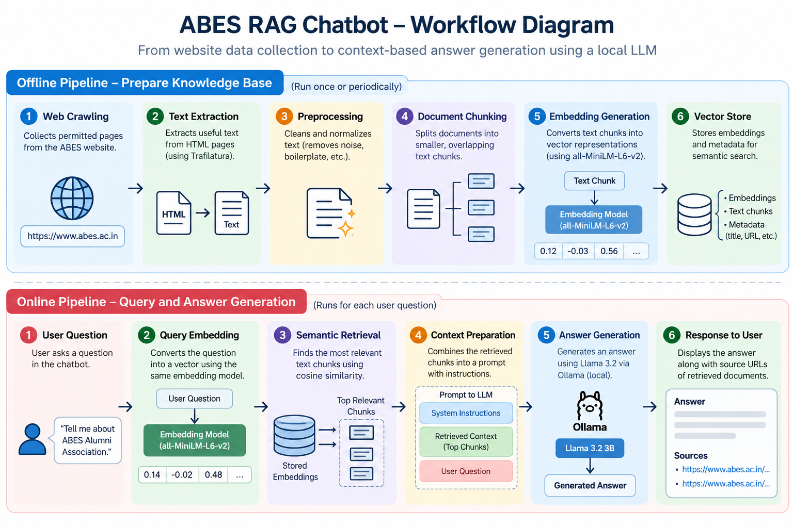
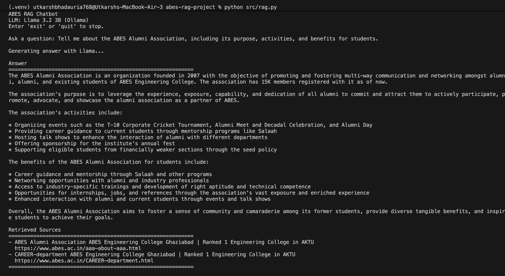
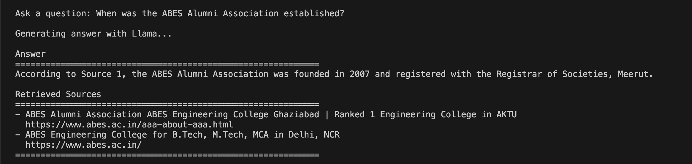

# ABES RAG Chatbot 🤖

A Retrieval-Augmented Generation (RAG) chatbot that answers questions using information extracted from the ABES Engineering College website.

The project combines semantic search with a locally running Large Language Model (LLM) to retrieve relevant information and generate context-based answers.

## 🚀 Overview

Traditional Large Language Models generate responses using their learned knowledge. A RAG system first retrieves relevant information from a knowledge base and then uses that information to generate an answer.

This project implements a basic end-to-end RAG pipeline, covering website data collection, text extraction, preprocessing, document chunking, embedding generation, semantic retrieval, and local LLM-based answer generation.

## 📸 Screenshots

### RAG Workflow



### Chatbot in Action — Example 1



### Chatbot in Action — Example 2



## ✨ Features

- **Web Crawling:** Collects permitted pages from the ABES website.
- **Text Extraction:** Extracts useful text from HTML pages.
- **Data Preprocessing:** Cleans and normalizes extracted content.
- **Document Chunking:** Splits documents into smaller, overlapping text segments.
- **Embedding Generation:** Converts text chunks into numerical vector representations.
- **Semantic Search:** Retrieves relevant chunks using cosine similarity.
- **Relevance Filtering:** Filters retrieved chunks using a configurable similarity threshold.
- **LLM Integration:** Uses Llama 3.2 through Ollama for local answer generation.
- **Context-Based Responses:** Generates answers using the retrieved document content.
- **Source URLs:** Displays the URLs of retrieved documents.
- **Data Exploration:** Uses a Jupyter Notebook to inspect and analyze extracted data.

## 🛠️ Tech Stack

| Technology            | Purpose                                       |
| --------------------- | --------------------------------------------- |
| Python                | Core implementation                           |
| Requests              | HTTP requests and API communication           |
| BeautifulSoup         | HTML parsing                                  |
| Trafilatura           | Main text extraction                          |
| Sentence Transformers | Text embeddings                               |
| all-MiniLM-L6-v2      | Embedding model                               |
| NumPy                 | Vector operations and similarity calculations |
| Ollama                | Local LLM inference                           |
| Llama 3.2 3B          | Answer generation                             |
| Pandas                | Data exploration                              |
| Jupyter Notebook      | Exploratory data analysis                     |

## 🏗️ Architecture

```text
                 ABES Website
                      |
                      v
                  Web Crawler
                      |
                      v
                HTML Documents
                      |
                      v
                 Text Extraction
                      |
                      v
               Data Preprocessing
                      |
                      v
                Document Chunking
                      |
                      v
               Embedding Generation
                      |
                      v
                Vector Representations
                      |
                      v
User Question --> Query Embedding
                      |
                      v
                Semantic Retrieval
                      |
                      v
               Relevant Text Chunks
                      |
                      v
                 Ollama + Llama
                      |
                      v
                Generated Answer
                      |
                      v
               Retrieved Source URLs
```

## 📂 Project Structure

```text
abes-rag-project/
│
├── data/
│   ├── raw/
│   │   ├── html/
│   │   └── pdf/
│   ├── manifests/
│   │   └── pages.jsonl
│   └── processed/
│
├── notebook/
│   └── data_exploration.ipynb
│
├── src/
│   ├── crawler.py
│   ├── extract.py
│   ├── preprocess.py
│   ├── chunk.py
│   ├── embeddings.py
│   └── rag.py
│
├── .gitignore
├── requirements.txt
└── README.md
```

Generated datasets, crawled HTML files, and embedding files are excluded from version control. They can be regenerated by running the pipeline.

## ⚙️ Installation and Setup

### Prerequisites

- Python 3.10 or newer recommended for a fresh installation.
- Git.
- Ollama installed and running.
- An internet connection for installing dependencies, downloading the language model, and collecting website data.

### 1. Clone the Repository

```bash
git clone https://github.com/UtkarshBhadauria-1/ABES_RAG_CHATBOT.git
cd abes-rag-project
```

Replace `https://github.com/UtkarshBhadauria-1/ABES_RAG_CHATBOT.git` with the URL of your GitHub repository.

### 2. Create a Virtual Environment

Create a Python virtual environment:

```bash
python3 -m venv .venv
```

Activate it.

**macOS / Linux**

```bash
source .venv/bin/activate
```

**Windows**

```bash
.venv\Scripts\activate
```

### 3. Install Python Dependencies

```bash
pip install -r requirements.txt
```

### 4. Install Ollama

Download and install Ollama from:

https://ollama.com/

Ollama allows language models to run locally without requiring a paid LLM API.

### 5. Download the Language Model

Download Llama 3.2 3B:

```bash
ollama pull llama3.2:3b
```

Verify that the model is available:

```bash
ollama list
```

The output should include:

```text
NAME
llama3.2:3b
```

### 6. Prepare the Knowledge Base

If the generated dataset is not included in the repository, run the pipeline from the project root.

**Step 1: Crawl permitted webpages**

```bash
python src/crawler.py
```

**Step 2: Extract text from HTML**

```bash
python src/extract.py
```

**Step 3: Clean and preprocess documents**

```bash
python src/preprocess.py
```

**Step 4: Split documents into chunks**

```bash
python src/chunk.py
```

**Step 5: Generate embeddings**

```bash
python src/embeddings.py
```

Run each script in order and verify that it completes successfully before proceeding to the next stage.

Review the crawler configuration before running it. Respect the website's robots.txt instructions, rate limits, and applicable terms.

### 7. Run the Chatbot

Make sure Ollama is running and the model is available.

Start the application:

```bash
python src/rag.py
```

Enter a question when prompted.

Example:

```text
Ask a question: Tell me about the alumni association at ABES.
```

The application retrieves relevant text chunks, generates an answer using Llama, and displays the URLs of the retrieved documents.

To exit the application, type:

```text
exit
```

## 🔍 How Retrieval Works

The project uses the `sentence-transformers/all-MiniLM-L6-v2` model to convert document chunks and user questions into vector representations.

The retrieval process follows these steps:

1. Convert the user's question into an embedding.
2. Calculate cosine similarity between the query embedding and stored document embeddings.
3. Rank document chunks by similarity score.
4. Retrieve up to three chunks that satisfy the configured similarity threshold.
5. Pass the retrieved context and question to Llama.
6. Generate a natural-language answer using the supplied context.
7. Display the answer and the URLs of the retrieved documents.

The current implementation uses NumPy for vector similarity calculations rather than a dedicated vector database.

The similarity threshold is a configurable heuristic. It may need to be adjusted as the knowledge base grows.

## 🧠 Role of the Language Model

Llama 3.2 3B generates answers from the context retrieved by the semantic search component.

The application instructs the model to:

- Answer using the supplied context.
- Avoid inventing unsupported facts.
- Acknowledge when the context does not contain sufficient information.
- Avoid inventing source URLs.

These instructions help constrain the model's responses but do not guarantee factual accuracy. Generated answers should be evaluated against the original source content.

## 📊 Current Project Status

The initial working prototype includes:

- Five crawled webpages.
- Eight generated text chunks.
- 384-dimensional embeddings generated using all-MiniLM-L6-v2.
- Cosine-similarity-based retrieval.
- Similarity-threshold filtering.
- Local answer generation using Llama 3.2 3B.
- Display of retrieved source URLs.

These figures describe the initial dataset and may change as more webpages are collected.

## ⚠️ Limitations

- The current knowledge base covers only a small subset of the ABES website.
- Answer quality depends on the relevance of retrieved content and the capabilities of the language model.
- Similarity scores do not guarantee that retrieved content is relevant.
- The language model may generate claims that are not fully supported by the retrieved context.
- Displayed source URLs identify retrieved documents but do not provide verified, claim-level citations.
- The application currently uses NumPy for vector retrieval instead of a dedicated vector database.
- The chatbot currently runs through a terminal interface.
- Retrieval and answer quality have not yet been evaluated using a comprehensive benchmark.

## 🔮 Future Improvements

- Expand the knowledge base with additional permitted webpages.
- Improve retrieval ranking and relevance filtering.
- Evaluate retrieval quality using a curated question dataset.
- Improve answer grounding and source attribution.
- Explore hybrid search and reranking techniques.
- Add a web interface using React.
- Introduce automated tests and structured logging.
- Evaluate performance on a larger knowledge base.
- Compare different embedding models and language models.

## 🎯 Learning Objectives

This project explores practical concepts in:

- Data collection and preprocessing
- Natural Language Processing (NLP)
- Text embeddings
- Semantic search
- Vector similarity
- Large Language Models (LLMs)
- Retrieval-Augmented Generation (RAG)
- Local AI inference
- Data exploration and analysis

## 📌 Disclaimer

This is an educational project developed to explore semantic search and Retrieval-Augmented Generation.

It is not an official ABES Engineering College application and is not affiliated with or endorsed by ABES Engineering College.

Website content remains the property of its respective owners.

## 👨‍💻 Author

**Utkarsh Bhadauria**

- GitHub: https://github.com/UtkarshBhadauria-1
- LinkedIn: https://www.linkedin.com/in/utkarsh-bhadauria-lz
